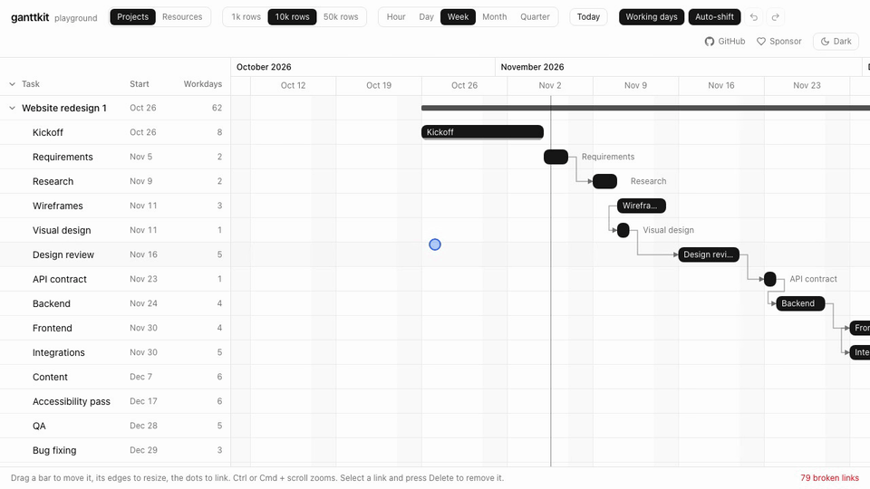

# ganttkit

[](https://www.npmjs.com/package/ganttkit)
[](https://github.com/ktimur91/ganttkit/actions/workflows/ci.yml)
[](LICENSE)
[](https://ko-fi.com/ktimur91)

Gantt chart for Vue 3 that lives in your codebase.

**[Live demo](https://ktimur91.github.io/ganttkit/)** with 1 000 to 50 000 rows, and a [resource view](https://ktimur91.github.io/ganttkit/?view=resources) with up to 10 000 people.

- **Headless core** (`ganttkit` on npm): `useGantt` handles dates, time zones, layout, virtual scrolling, drag and drop, dependencies and zoom. No styles, no DOM assumptions beyond a scroll container.
- **Copy-in components** in the shadcn-vue style: `npx shadcn-vue add` puts plain `.vue` files into `components/ui/gantt`. Restyle them with Tailwind, change the markup, keep the core updatable from npm.
- **Fast with big plans**: 50 000 rows render about 40 rows and their bars. Scrolling recomputes the window only when it crosses a chunk of rows.



## Features

- Tasks, milestones and summary bars, nested rows with collapse, one header button collapses or expands all
- Drag to move, drag edges to resize, keyboard nudging (arrows move, Shift + arrows resize)
- Dependencies: FS, SS, FF, SF. Create by dragging from a bar's dot, cycle and duplicate protection, broken links highlighted, Delete removes the selected link
- Auto-shift: when a task moves past its successors, they move forward with it, keeping their length
- Resource view: overlapping bars stack into lanes and the row grows, double bookings are marked, drag a bar to another row or press Alt + Up/Down
- Right-click menu on a bar: "Move to" with search, free rows first and busy ones marked, plus your own actions
- Tooltip with dates and duration, showing the new ones while you drag
- Zoom levels from hours to quarters, Ctrl/Cmd + wheel zooms around the pointer
- Working calendars: weekends and holidays are skipped when you drag, resize or nudge, lengths stay in working days, days off are shaded
- Undo and redo with `useGanttHistory`
- Time zone aware: day, week and month boundaries follow the zone you pass, DST days are 23 or 25 hours long
- Edits come back in your date format: `'2026-11-02'` stays a date string, `Date` stays a `Date`
- Light and dark theme through shadcn-vue CSS variables

## Requirements

Vue 3.5+. The components also need Tailwind CSS v4 and a project set up with [shadcn-vue](https://www.shadcn-vue.com/docs/installation).

## Install

```bash
npx shadcn-vue@latest add @ganttkit/gantt
```

ganttkit is listed in the [shadcn-vue registry directory](https://www.shadcn-vue.com/docs/directory). With an older CLI use the full URL: `npx shadcn-vue@latest add https://ktimur91.github.io/ganttkit/r/gantt.json`

This copies the components into `components/ui/gantt` and installs `ganttkit`. To build your own UI on the core only:

```bash
npm install ganttkit
```

## Usage

One task per row: rows with `start` and `end` become bars.

```vue
<script setup lang="ts">
import { ref } from 'vue'
import { Gantt } from '@/components/ui/gantt'

const tasks = ref([
  { id: 'design', name: 'Design', start: '2026-11-02', end: '2026-11-06', progress: 0.5 },
  { id: 'build', name: 'Build', start: '2026-11-06', end: '2026-11-20' },
  { id: 'launch', name: 'Launch', start: '2026-11-20', end: '2026-11-20' },
])
const links = ref([{ id: 1, from: 'design', to: 'build' }])
</script>

<template>
  <Gantt v-model:rows="tasks" v-model:links="links" zoom="week" class="h-[600px]" />
</template>
```

Rows and bars can be separate, for example bookings in people's rows. Each booking has a `rowId`, see [Resources](#resources).

### Data model

| field | |
| --- | --- |
| `row.id`, `row.parentId` | Rows form a tree through `parentId`. |
| `item.start`, `item.end` | `Date`, epoch ms, `YYYY-MM-DD` or ISO string. `end` is exclusive: a one-day task on Nov 2 ends on `'2026-11-03'`. `end <= start` is a milestone. |
| `item.rowId` | Row of the bar. Defaults to the item's own `id`. |
| `item.name`, `item.progress`, `item.color`, `item.type` | Used by the default bar: label, progress from 0 to 1, CSS color, `'summary'` for a project bar. |
| `link.from`, `link.to`, `link.type` | Item ids and `'FS' \| 'SS' \| 'FF' \| 'SF'` (default `FS`). |

Date strings without an offset are read in `timeZone` (the browser's zone by default).

### `<Gantt>` props

| prop | default | |
| --- | --- | --- |
| `rows` | required | Sidebar rows. |
| `items` | rows with dates | Bars. Omit for one task per row. |
| `links` | `[]` | Dependencies. |
| `v-model:zoom` | `'week'` | `'hour' \| 'day' \| 'week' \| 'month' \| 'quarter'` |
| `time-zone` | browser zone | IANA zone, e.g. `'Europe/Berlin'`. |
| `locale` | browser locale | Locale for the timescale labels. |
| `row-height` | `36` | Row height in px. |
| `sidebar-width` | `280` | Sidebar width in px. |
| `calendar` | | Working days and holidays, see [Working calendars](#working-calendars). |
| `editable` | `true` | `false`, or `{ move, resize, link, reassign }` to switch parts off. |
| `is-item-editable` | | `(item) => boolean`, e.g. to lock summary bars. |
| `auto-shift` | `false` | Push successors forward after an edit, see [Auto-shift](#auto-shift). |
| `stack-overlaps` | `true` | Overlapping bars of a row stack into lanes and the row grows. |
| `get-row-capacity` | `1` | `(row) => number`: bars a row can run at once before it counts as overloaded. |
| `can-move-to-row` | all rows | `(item, row) => boolean`: rows a bar may be dragged to. |
| `tooltip` | `true` | Dates and duration on hover and while dragging. |
| `context-menu` | `true` | Right-click menu on bars, see [Resources](#resources). |
| `snap` | by zoom | `'hour' \| 'day' \| 'week'`, a step in ms, or `false`. |
| `range` | from items | Fixed `{ start, end }` of the timeline. |
| `week-starts-on` | `1` | `0` for Sunday. |
| `initial-date` | today | Centered when the chart first gets a size, `null` to keep the start. |

### Events

| event | payload |
| --- | --- |
| `update:rows`, `update:items`, `update:links` | New array, for `v-model`. `update:rows` fires in one-task-per-row mode. |
| `item-change` | `{ item, start, end, startMs, endMs, rowId?, source }` with dates in the item's own format. `rowId` is set when the bar moved to another row, `source` is `'edit'` or `'auto-shift'`. Fires once per changed item. |
| `items-change` | All changes of one edit at once: the edited item first, then the successors auto-shift moved. Use it for one undo step or one save request. |
| `item-click` | The item. |
| `link-create`, `link-delete` | The link. |

### Slots

| slot | props |
| --- | --- |
| `sidebar-header` | |
| `row` | `{ row, id, depth, hasChildren, expanded, top, height, lanes, overloads }` |
| `bar` | Bar state: `{ item, start, end, x, y, width, height, lane, milestone, dragging }` |
| `tooltip` | `{ bar, description: { dates, duration }, movingTo }`, `movingTo` is the target row while a bar is dragged to another one. |
| `menu` | `{ item, close }`: your own actions at the top of the right-click menu. With this slot the menu opens in every mode, not only for resources. |
| `timeline` | Extra layers inside the timeline, e.g. markers. |

### Resources

Pass people (or machines, rooms) as `rows` and their bookings as `items` with a `rowId`:

```vue
<Gantt
  :rows="people"
  v-model:items="bookings"
  :can-move-to-row="(booking, person) => !person.isTeam"
  :get-row-capacity="(person) => person.capacity ?? 1"
/>
```

- Bookings that overlap stack into lanes, and the row grows to fit them. Pass `:stack-overlaps="false"` to draw them on top of each other instead.
- Where a row runs more bookings at once than its capacity, the time is shaded red and the row gets a red dot. `gantt.overloads` maps row ids to these time ranges, e.g. for a "3 people double-booked" counter.
- Right-click a booking (or press the Menu key or Shift + F10 on a focused one) for "Move to": a searchable list of rows, free ones first, the ones already busy at that time marked. It reaches collapsed rows too, so you do not have to drag past fifty people. `gantt.moveTargets(id)` and `gantt.moveItemToRow(id, rowId)` give you the same in your own UI.
- Dragging a booking up or down moves it to another row, Alt + Up/Down does the same from the keyboard. `item-change` then carries the new `rowId`, and `v-model:items` writes it into the booking. Rows rejected by `can-move-to-row` are skipped.

### Auto-shift

```vue
<Gantt :rows="tasks" v-model:links="links" auto-shift @items-change="save" />
```

When an edit breaks a link (a task now ends after its successor starts), the successor moves forward just enough, and so on down the chain. Lengths stay the same, in working days with a [calendar](#working-calendars). Items only move later, never earlier, and read-only items stay put with their link shown as broken. The drag preview shows the shifted tasks before you let go.

### Working calendars

```vue
<Gantt
  :rows="tasks"
  :calendar="{ holidays: ['2026-12-25', '2026-12-26', '2027-01-01'] }"
/>
```

| field | default | |
| --- | --- | --- |
| `workingWeekdays` | `[1, 2, 3, 4, 5]` | Working days of the week, `0` is Sunday. |
| `holidays` | | Days off on top of the weekly pattern, as `YYYY-MM-DD` or `Date`. |
| `workingDates` | | Working days that override the pattern, e.g. a working Saturday. |

With a calendar and day snapping (day, week and month zoom), moving a task keeps its length in working days, a day off under the pointer snaps to the next working day, and arrow keys step by working days. At the hour zoom the calendar only shades days off. Days off are shaded wherever a day is at least 10px wide (hour, day and week zoom). Without a calendar, weekends are shaded and edits use calendar days.

`createCalendar(rules, timeZone)` gives you the same rules in your own code, for example `countWorkingDays(start, end)` for a duration column.

### Undo, redo and optimistic saves

`item-change` fires once per item, when a drag ends. Your app owns the data, so undo and rollback are a matter of keeping the previous array:

```ts
import { useGanttHistory } from 'ganttkit'

const tasks = shallowRef(initialTasks)
const history = useGanttHistory(tasks)

async function onItemChange({ item, start, end }: ItemChange<Task>) {
  const update = (from: DateInput, to: DateInput) =>
    history.commit(tasks.value.map((t) => (t.id === item.id ? { ...t, start: from, end: to } : t)))
  update(start, end)
  try {
    await api.saveTask(item.id, start, end)
  } catch {
    // `item` is the unchanged task, so it still holds the old dates.
    update(item.start, item.end)
  }
}

// history.undo(), history.redo(), history.canUndo, history.canRedo
```

Snapshots are the array references, so keep updates immutable (`map`, spread) and nothing gets copied.

With `auto-shift` one edit can change several tasks. Listen to `items-change` instead to make it one undo step:

```ts
function onItemsChange(changes: ItemChange<Task>[]) {
  const byId = new Map(changes.map((change) => [change.item.id, change]))
  history.commit(tasks.value.map((t) => {
    const change = byId.get(t.id)
    return change ? { ...t, start: change.start, end: change.end } : t
  }))
}
```

### Headless

```ts
import { useGantt } from 'ganttkit'

const gantt = useGantt({
  rows,
  items,
  links,
  timeZone: 'Europe/Berlin',
  zoom,
  onItemChange: ({ item, start, end }) => save(item.id, start, end),
  onLinkCreate: (link) => addLink(link),
})

// Bind the scroll container: gantt.viewportEl.value = element
// Render gantt.visibleRows, gantt.visibleBars, gantt.visibleLinks and gantt.ticks
// Wire gantt.startDrag(event, id, mode) and gantt.startLink(event, id, side)
// Keyboard: gantt.nudge(id, mode, steps) and gantt.moveToRow(id, 1 | -1)
// Rows: gantt.toggleRow(id), gantt.expandAll(), gantt.collapseAll(), gantt.allExpanded
```

See [`registry/gantt`](registry/gantt) for a complete implementation.

## Support

- Bugs and feature requests: [Issues](https://github.com/ktimur91/ganttkit/issues)
- Questions and ideas: [Discussions](https://github.com/ktimur91/ganttkit/discussions)

ganttkit is free and MIT licensed. If it saves you time, you can support its development:

[](https://ko-fi.com/ktimur91)

## Contributing

Issues and pull requests are welcome. See [CONTRIBUTING.md](CONTRIBUTING.md) for the setup, the project layout and how to run the tests.

## Development

```bash
pnpm install
pnpm dev            # playground on http://localhost:5280, ?zoom=month&theme=dark work too
pnpm test           # core tests
pnpm e2e            # Playwright: Chromium, Firefox, WebKit, Android and iPhone profiles
pnpm typecheck
pnpm registry:build
pnpm --filter playground record:gif   # re-record docs/demo.gif, needs pnpm preview running
```

```
packages/core     ganttkit on npm: useGantt and the pure date, layout and link math
registry/gantt    shadcn-vue components
apps/playground   demo with 1 000 to 50 000 rows
```

Releases: bump `packages/core/package.json`, then push a matching `vX.Y.Z` tag. GitHub Actions publishes to npm with provenance.

## License

MIT
