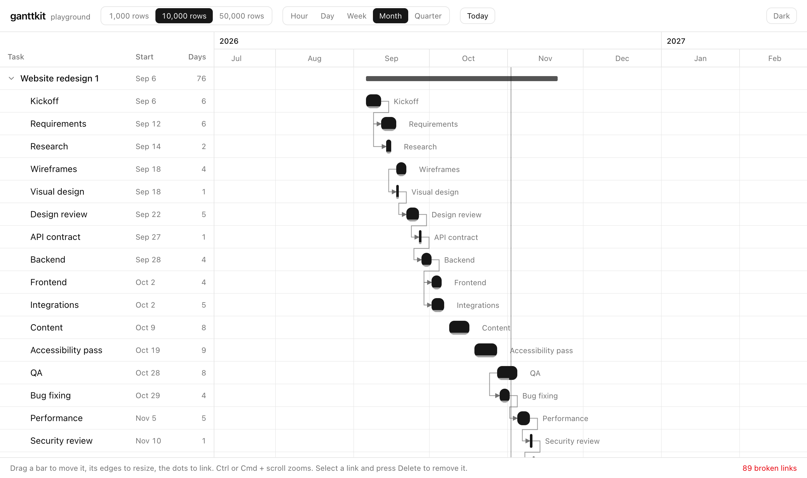

# ganttkit

[](https://www.npmjs.com/package/ganttkit)
[](https://github.com/ktimur91/ganttkit/actions/workflows/ci.yml)
[](LICENSE)
[](https://ko-fi.com/ktimur91)

Gantt chart for Vue 3 that lives in your codebase.

**[Live demo](https://ktimur91.github.io/ganttkit/)** with 1 000 to 50 000 rows.

- **Headless core** (`ganttkit` on npm): `useGantt` handles dates, time zones, layout, virtual scrolling, drag and drop, dependencies and zoom. No styles, no DOM assumptions beyond a scroll container.
- **Copy-in components** in the shadcn-vue style: `npx shadcn-vue add` puts plain `.vue` files into `components/ui/gantt`. Restyle them with Tailwind, change the markup, keep the core updatable from npm.
- **Fast with big plans**: 50 000 rows render about 40 rows and their bars. Scrolling recomputes the window only when it crosses a chunk of rows.

<picture>
  <source media="(prefers-color-scheme: dark)" srcset="docs/screenshot-dark.png">
  
</picture>

## Features

- Tasks, milestones and summary bars, nested rows with collapse
- Drag to move, drag edges to resize, keyboard nudging (arrows move, Shift + arrows resize)
- Dependencies: FS, SS, FF, SF. Create by dragging from a bar's dot, cycle and duplicate protection, broken links highlighted, Delete removes the selected link
- Zoom levels from hours to quarters, Ctrl/Cmd + wheel zooms around the pointer
- Time zone aware: day, week and month boundaries follow the zone you pass, DST days are 23 or 25 hours long
- Edits come back in your date format: `'2026-11-02'` stays a date string, `Date` stays a `Date`
- Light and dark theme through shadcn-vue CSS variables

## Requirements

Vue 3.5+. The components also need Tailwind CSS v4 and a project set up with [shadcn-vue](https://www.shadcn-vue.com/docs/installation).

## Install

```bash
npx shadcn-vue@latest add https://ktimur91.github.io/ganttkit/r/gantt.json
```

This copies the components into `components/ui/gantt` and installs `ganttkit`. To build your own UI on the core only:

```bash
npm install ganttkit
```

## Usage

One task per row: rows with `start` and `end` become bars.

```vue
<script setup lang="ts">
import { ref } from 'vue'
import { Gantt } from '@/components/ui/gantt'

const tasks = ref([
  { id: 'design', name: 'Design', start: '2026-11-02', end: '2026-11-06', progress: 0.5 },
  { id: 'build', name: 'Build', start: '2026-11-06', end: '2026-11-20' },
  { id: 'launch', name: 'Launch', start: '2026-11-20', end: '2026-11-20' },
])
const links = ref([{ id: 1, from: 'design', to: 'build' }])
</script>

<template>
  <Gantt v-model:rows="tasks" v-model:links="links" zoom="week" class="h-[600px]" />
</template>
```

Rows and bars can be separate, for example several shifts in one person's row. Each shift has a `rowId`:

```vue
<Gantt :rows="people" v-model:items="shifts" time-zone="Asia/Almaty" zoom="hour" />
```

### Data model

| field | |
| --- | --- |
| `row.id`, `row.parentId` | Rows form a tree through `parentId`. |
| `item.start`, `item.end` | `Date`, epoch ms, `YYYY-MM-DD` or ISO string. `end` is exclusive: a one-day task on Nov 2 ends on `'2026-11-03'`. `end <= start` is a milestone. |
| `item.rowId` | Row of the bar. Defaults to the item's own `id`. |
| `item.name`, `item.progress`, `item.color`, `item.type` | Used by the default bar: label, progress from 0 to 1, CSS color, `'summary'` for a project bar. |
| `link.from`, `link.to`, `link.type` | Item ids and `'FS' \| 'SS' \| 'FF' \| 'SF'` (default `FS`). |

Date strings without an offset are read in `timeZone` (the browser's zone by default).

### `<Gantt>` props

| prop | default | |
| --- | --- | --- |
| `rows` | required | Sidebar rows. |
| `items` | rows with dates | Bars. Omit for one task per row. |
| `links` | `[]` | Dependencies. |
| `v-model:zoom` | `'week'` | `'hour' \| 'day' \| 'week' \| 'month' \| 'quarter'` |
| `time-zone` | browser zone | IANA zone, e.g. `'Europe/Berlin'`. |
| `locale` | browser locale | Locale for the timescale labels. |
| `row-height` | `36` | Row height in px. |
| `sidebar-width` | `280` | Sidebar width in px. |
| `editable` | `true` | `false`, or `{ move, resize, link }` to switch parts off. |
| `is-item-editable` | | `(item) => boolean`, e.g. to lock summary bars. |
| `snap` | by zoom | `'hour' \| 'day' \| 'week'`, a step in ms, or `false`. |
| `range` | from items | Fixed `{ start, end }` of the timeline. |
| `week-starts-on` | `1` | `0` for Sunday. |
| `initial-date` | today | Centered when the chart first gets a size, `null` to keep the start. |

### Events

| event | payload |
| --- | --- |
| `update:rows`, `update:items`, `update:links` | New array, for `v-model`. `update:rows` fires in one-task-per-row mode. |
| `item-change` | `{ item, start, end, startMs, endMs }` with dates in the item's own format. |
| `item-click` | The item. |
| `link-create`, `link-delete` | The link. |

### Slots

| slot | props |
| --- | --- |
| `sidebar-header` | |
| `row` | `{ row, id, depth, hasChildren, expanded, top }` |
| `bar` | Bar state: `{ item, start, end, x, y, width, height, milestone, dragging }` |
| `timeline` | Extra layers inside the timeline, e.g. markers. |

### Headless

```ts
import { useGantt } from 'ganttkit'

const gantt = useGantt({
  rows,
  items,
  links,
  timeZone: 'Europe/Berlin',
  zoom,
  onItemChange: ({ item, start, end }) => save(item.id, start, end),
  onLinkCreate: (link) => addLink(link),
})

// Bind the scroll container: gantt.viewportEl.value = element
// Render gantt.visibleRows, gantt.visibleBars, gantt.visibleLinks and gantt.ticks
// Wire gantt.startDrag(event, id, mode) and gantt.startLink(event, id, side)
```

See [`registry/gantt`](registry/gantt) for a complete implementation.

## Support

- Bugs and feature requests: [Issues](https://github.com/ktimur91/ganttkit/issues)
- Questions and ideas: [Discussions](https://github.com/ktimur91/ganttkit/discussions)

ganttkit is free and MIT licensed. If it saves you time, you can support its development:

[](https://ko-fi.com/ktimur91)

## Development

```bash
pnpm install
pnpm dev            # playground on http://localhost:5280, ?zoom=month&theme=dark work too
pnpm test           # core tests
pnpm typecheck
pnpm registry:build
```

```
packages/core     ganttkit on npm: useGantt and the pure date, layout and link math
registry/gantt    shadcn-vue components
apps/playground   demo with 1 000 to 50 000 rows
```

Releases: bump `packages/core/package.json`, then push a matching `vX.Y.Z` tag. GitHub Actions publishes to npm with provenance.

## License

MIT
